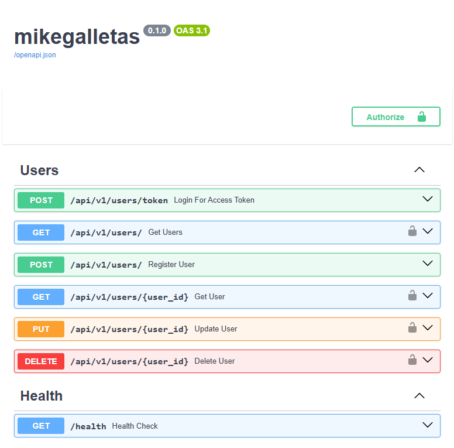

<p align="center">
  
</p>

<h1 align="center">FastAPI Mike Wizard</h1>

<p align="center">
  Crea una base lista para empezar tu próxima API con FastAPI.
  <br>
  <strong>Python 3.10+ · Windows · Linux · macOS</strong>
</p>

<p align="center">
  <a href="#ejecutar-el-wizard">Empezar</a> ·
  <a href="#qué-genera">Qué incluye</a> ·
  <a href="#qué-no-hace--limitaciones">Limitaciones</a>
</p>

---

Asistente interactivo que genera una estructura inicial para un proyecto FastAPI.

## Requisitos

- Python 3.10+ disponible en PATH (`python` en Windows; normalmente `python3`
  en Linux/macOS).
- Acceso a Internet la primera vez para crear el entorno e instalar paquetes.
- Docker Desktop en Windows/macOS o Docker Engine y Docker Compose en Linux
  si se quieren iniciar PostgreSQL, MySQL/MariaDB, Redis y MinIO.

SQLite no requiere Docker ni un servicio de base de datos externo.

## Ejecutar el wizard

Desde la carpeta que contiene `wizard.py`:

### Windows (CMD o PowerShell)

```bat
python wizard.py
```

### Linux y macOS

```sh
python3 wizard.py
```

El wizard pide primero el nombre del proyecto y crea una subcarpeta con ese
nombre. Crea un `.venv` dentro de ella, instala las dependencias del propio
wizard y ejecuta las preguntas desde ese entorno. Si la carpeta del proyecto
ya existe y contiene archivos, se detiene para no sobrescribirlos.
Las dependencias del wizard (incluyendo Pillow para el banner pixel-art) se
declaran en el `requirements.txt` de este repositorio; no se agregan al proyecto
FastAPI generado.

Al iniciar, limpia la vista de la terminal y dibuja el cubo pixel-art usando
colores ANSI de 24 bits. Se recomienda Windows Terminal, PowerShell moderno,
macOS Terminal/iTerm2 o una terminal Linux con soporte true-color.

Al terminar abre una consola nueva en Windows, con `.venv` activado. En Linux y
macOS continúa en la terminal actual y abre una shell interactiva con `.venv`
activado (bash/zsh; también contempla fish); escribe `exit` para volver a la
shell anterior.

## Qué genera

- `.env` con los valores de configuración, secretos y URL de base de datos.
- `docker-compose.yml` con la base de datos elegida (salvo SQLite), Redis y
  MinIO.
- `.venv`, `requirements.txt` y `.gitignore`.
- Si se acepta el módulo Usuario: `main.py`, configuración, conexión SQLModel,
  modelo y esquemas de usuario, registro, login OAuth2/JWT y CRUD.
- Si se acepta Alembic: `alembic.ini`, `alembic/env.py` y la plantilla de
  revisiones.
- `minio_data/` como carpeta de datos local para MinIO.

El CRUD de usuario exige un token Bearer, excepto el registro y el endpoint de
login. La política inicial permite a cualquier usuario autenticado gestionar
cualquier cuenta; no hay roles ni permisos de administrador. No publiques esa
API sin implementar una autorización más restrictiva.

## API generada

La captura muestra la documentación Swagger UI y los endpoints que aparecen
cuando se genera el módulo Usuario:

<p align="center">
  
</p>

Incluye login JWT, registro, operaciones CRUD protegidas y el health check.

## Primer arranque de la API

Desde la carpeta del proyecto generado:

```sh
docker compose up -d
```

Si se eligió Alembic, espera a que la base de datos esté lista y crea/aplica la
migración inicial:

```sh
alembic revision --autogenerate -m "initial"
alembic upgrade head
```

Alembic no crea automáticamente la revisión inicial. Si no se eligió Alembic,
la aplicación crea las tablas SQLModel al arrancar.

Inicia el servidor de desarrollo con:

```sh
fastapi dev
```

Si usas [uv](https://docs.astral.sh/uv/), también puedes iniciarlo con:

```sh
uv run fastapi dev
```

La documentación interactiva estará disponible normalmente en
`http://127.0.0.1:8000/docs`.

## Qué no hace / limitaciones

- No migra ni modifica proyectos anteriores; cada proyecto nuevo se genera
  desde cero.
- No crea una revisión inicial de Alembic ni la aplica automáticamente.
- No implementa roles, permisos, recuperación de contraseña, refresh tokens,
  verificación de correo ni cierre/revocación de sesiones JWT.
- Aunque el wizard pregunta por Redis y MinIO, la API generada no los usa aún.
- No genera pruebas para la API creada ni configura CI/CD, despliegue, HTTPS,
  monitorización, backups o gestión de secretos de producción.
- CORS solo trae orígenes locales de desarrollo por defecto; hay que ajustarlo
  para el frontend y el entorno de despliegue.
- Las credenciales de los servicios se guardan en `.env`; protege ese archivo
  y no lo subas al repositorio.
- El wizard y las pruebas se validan en el entorno de desarrollo actual; no se
  garantiza que Docker o cada imagen de servicio se comporte igual en todas
  las instalaciones/plataformas.

## Ejecutar las pruebas del wizard

Desde la carpeta del generador:

```sh
python -m unittest discover -s tests -v
```

En sistemas donde el ejecutable se llame `python3`:

```sh
python3 -m unittest discover -s tests -v
```
